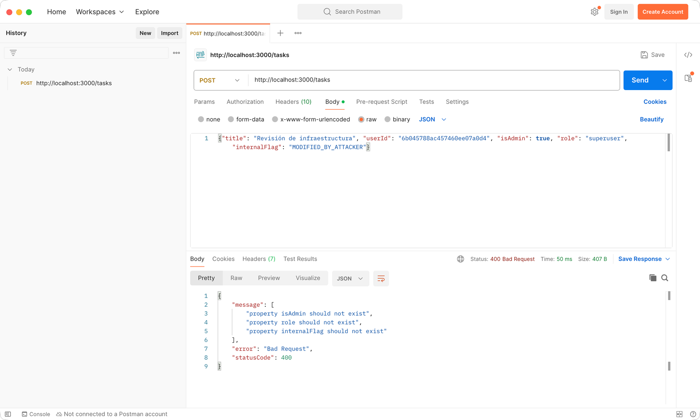
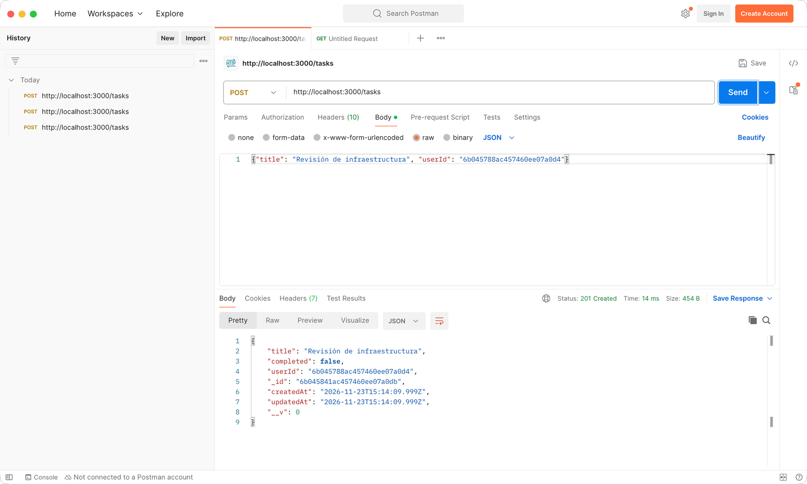
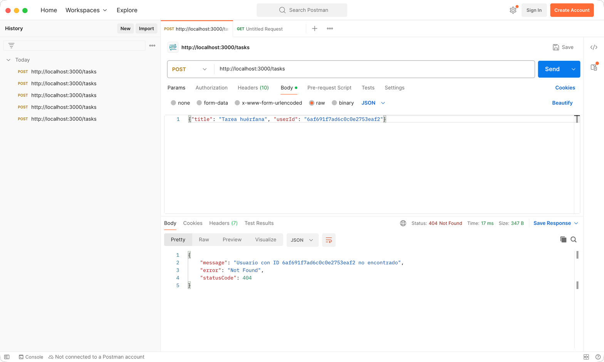
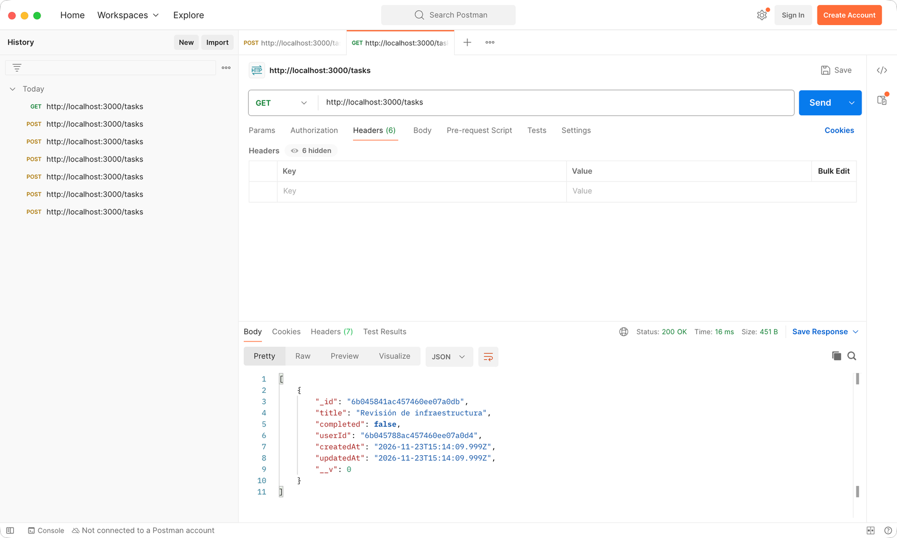
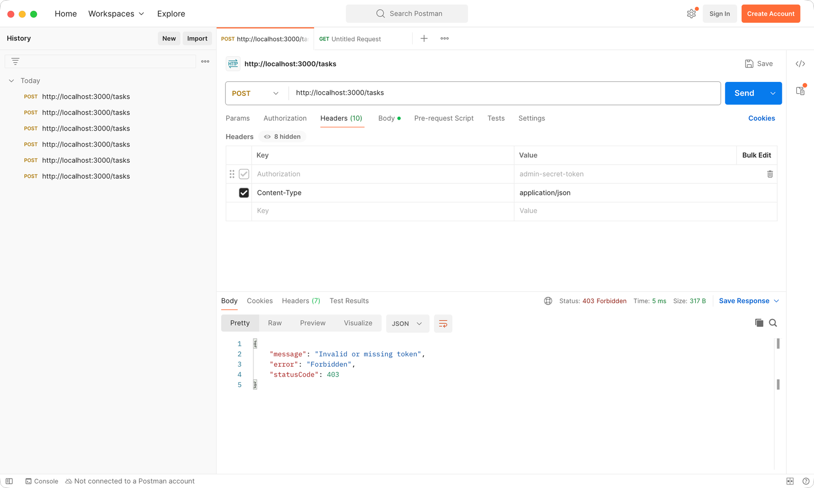
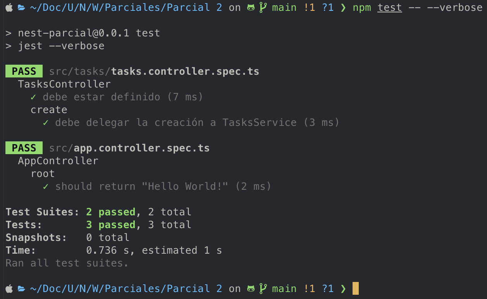

# Proyecto Base - Parcial Práctico Backend (NestJS + MongoDB)

API REST en NestJS y Mongoose para la gestión de **Usuarios (`/users`)** y **Tareas (`/tasks`)**.

---

## Requisitos Previos

- **Node.js** 18+ y **npm**
- **Docker Desktop** (o instancia local de MongoDB en el puerto `27017`)

---

## Instalación y Puesta en Marcha

1. **Levantar la base de datos MongoDB:**
   ```bash
   docker compose up -d
   ```
   *(Si utilizas una instancia local o MongoDB Atlas diferente a `mongodb://localhost:27017/nest-parcial`, configura la variable `MONGODB_URI` en un archivo `.env` tomando como base `.env.example`.)*

2. **Instalar dependencias del proyecto:**
   ```bash
   npm install
   ```

3. **Iniciar la aplicación en modo desarrollo:**
   ```bash
   npm run start:dev
   ```
   El servidor quedará disponible en `http://localhost:3000`.

---

## Pruebas y Validación

- **Ejecutar pruebas unitarias:**
  ```bash
  npm test
  ```
- **Ejecutar pruebas end-to-end:**
  ```bash
  npm run test:e2e
  ```
- **Verificar compilación y linter:**
  ```bash
  npm run build
  npm run lint
  ```

---

## Endpoints del Sistema

| Método | Ruta | Acceso | Descripción |
| :--- | :--- | :--- | :--- |
| `GET` | `/` | Público | Verificación básica del servidor |
| `POST` | `/users` | Público | Crear usuario (`name`, `email`) |
| `GET` | `/users` | Público | Listar usuarios registrados |
| `GET` | `/users/:id` | Público | Consultar usuario por ID |
| `GET` | `/tasks` | Público | Listar tareas registradas |
| `GET` | `/tasks/:id` | Público | Consultar tarea por ID |
| `POST` | `/tasks` | Restringido (`Authorization: admin-secret-token`) | Crear una tarea asociada a un usuario |

También puedes importar `nest-parcial.postman_collection.json` en Postman o utilizar `requests.http` con la extensión REST Client de VS Code para probar manualmente los endpoints.

---

## Evidencia de Funcionamiento

Pruebas realizadas en Postman con la aplicación compilada (`npm run build` y `npm run start:prod`) contra MongoDB en Docker, usando un usuario creado previamente (`6b045788ac457460ee07a0d4`).

### Caso 1 - Atributos no autorizados al crear tareas

Se agregó `CreateTaskDto`, un `ValidationPipe` global que rechaza propiedades no permitidas y el esquema de tareas se configuró como estricto.

Petición con `isAdmin`, `role` e `internalFlag` → `400 Bad Request`:



Petición solo con atributos permitidos → `201 Created`:



Consulta directa en MongoDB (`db.tasks.find()`): el documento solo contiene los campos del esquema.

```js
[
  {
    _id: ObjectId('6b045841ac457460ee07a0db'),
    title: 'Revisión de infraestructura',
    completed: false,
    userId: ObjectId('6b045788ac457460ee07a0d4'),
    createdAt: ISODate('2026-11-23T15:14:09.999Z'),
    updatedAt: ISODate('2026-11-23T15:14:09.999Z'),
    __v: 0
  }
]
```

### Caso 2 - Acoplamiento con la colección de usuarios

`UsersModule` exporta `UsersService` y `TasksModule` lo importa; la verificación del usuario se hace a través de ese servicio, sin acceso directo a `UserModel`.

Creación con un usuario inexistente → `404 Not Found`, respondido por `UsersService`:



### Caso 3 - Control de acceso a `/tasks`

Se reemplazó el middleware por un `AuthGuard` aplicado únicamente a `POST /tasks`.

`GET /tasks` sin cabeceras → `200 OK`:



`POST /tasks` sin `Authorization` → `403 Forbidden`:



### Caso 4 - Controlador desacoplado de los modelos

`TasksController` depende solo de `TasksService`, que ahora contiene la lógica de creación en `create`.

`npm test -- --verbose` con la prueba del controlador simulando únicamente `TasksService`:



`npm run build` y `npm run lint` finalizan sin errores.
